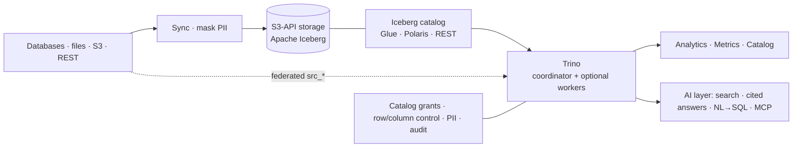
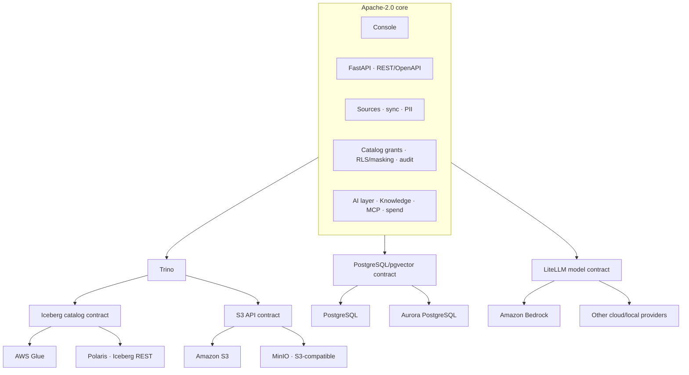

# DataPond — A lightweight, open lakehouse for small and mid-size teams on AWS

> **A data lake and data platform you can start on one node in your own AWS account: data in S3 as Apache Iceberg, tables in an Iceberg catalog, SQL through Trino. Every layer is an open standard, so storage, catalog, engine and models can change without your data or SQL changing. AI search and agents sit on top of the same governed data.**

DataPond is an open-core lakehouse for teams that use AWS heavily, may use or have looked at Databricks, and find a full platform too heavy for their size. It lands data from databases, files, S3 and REST sources into Iceberg tables, catalogs them, and queries the lake and the source databases together through Trino — with catalog grants, row filters, column masking, Korean PII masking and audit applied at the data layer. **AWS is the reference deployment, not the product boundary**: the same Helm chart runs on S3-compatible storage, an Iceberg REST catalog (Polaris) and any Kubernetes.

Direction and its reasons: [docs/POSITIONING_V7.md](docs/POSITIONING_V7.md). Product concept: [docs/PRODUCT_CONCEPT.md](docs/PRODUCT_CONCEPT.md).

## Open by layer

| Layer | Open standard | AWS reference | Can be replaced by | Status |
|---|---|---|---|---|
| Object storage | S3 API | Amazon S3 | MinIO or any S3-compatible store | Shipped (MinIO installed from nothing on every CI run) |
| Tables | Apache Iceberg + Parquet | Iceberg | — | Shipped |
| Catalog | Glue · Iceberg REST | AWS Glue | Polaris or another Iceberg REST catalog | Shipped; Glue exit path via catalog export (2.6) |
| Query engine | Trino (distributed SQL) | In-cluster Trino 482 | The same Trino on any Kubernetes; add workers to scale | Shipped (Athena removed in 2.4) |
| App state | PostgreSQL + pgvector | Aurora PostgreSQL | PostgreSQL | Shipped |
| Models | OpenAI-compatible via LiteLLM | Bedrock | Other cloud or local (Ollama) models | Shipped |
| Deployment | Helm · Kubernetes | EC2/K3s single node | Another Kubernetes | Shipped (EKS module is roadmap) |

**Leaving Glue** is a call, not a project: `POST /api/catalogs/{name}/export` registers a catalog's Iceberg tables in another catalog without copying data (plan by default; `apply` registers and compares row counts on both sides). See [Portability](docs/PORTABILITY.md).

## Core workflow



1. **Connect** sources: PostgreSQL, MySQL, SQL Server, Oracle and MongoDB become Trino catalogs `src_<slug>`; REST, custom Python and S3 sources are read by the backend.
2. **Land** them as Iceberg tables (full, incremental, or merge on key columns), with PII masked inside the sync so raw values never reach the lake.
3. **Organize** in the catalog; register more catalogs and grant who may use each.
4. **Query** the lake and the live sources together in Analytics, or through approved Metrics.
5. **Add AI** on the same data: Knowledge search and cited answers, NL→SQL, and agents through MCP/REST with per-caller keys, audit and spend limits.

## Architecture



Optional add-ons (Airflow transforms, RisingWave streaming, Jupyter, MLflow, Spark, OpenMetadata) are capability-gated: a disabled one is absent, and the console shows only what a deployment runs.

## Deployment profiles

| Helm values | Product role | What it actually does |
|---|---|---|
| `values-foundation.yaml` | **Portable Core · AWS starter** | About five workloads: backend, frontend, PostgreSQL/pgvector, LiteLLM, Valkey; external native S3 + Bedrock; no catalog/query service |
| `values-sovereign-core.yaml` | **Sovereign Core** | On-prem twin of the AWS starter: core five + in-cluster MinIO + Ollama; no catalog/query, no add-ons, no egress |
| `values-prod-single.yaml` | **AWS Single-Node Reference** | EC2/K3s application node with external Aurora, S3, Glue, Bedrock, ECR, TLS, and CloudWatch metrics, Trino in-cluster; not application-node HA |
| `values-aws.yaml` | **AWS Hybrid Extended compatibility** | Connects an existing Kubernetes cluster to S3, Bedrock, and external PostgreSQL; states none of the OSS add-on flags, so a fresh install renders none and an existing cluster keeps whatever it is already running; does not provision EKS |
| `values-onprem.yaml` | **Sovereign OSS Extended** | Self-hosted core plus selected local/OSS services; higher operational footprint |
| `values-dev.yaml`, `values-quicktest.yaml` | Development/test | Reduced-resource integration environments |
| `values-prod.yaml` | Self-hosted extended compatibility | Large full-stack profile; not the recommended AWS reference |

See [Deployment Profiles](docs/DEPLOYMENT_PROFILES.md) before choosing a profile.

## Quick start

**Lakehouse on AWS (the reference):** follow [Deploying the AWS Single-Node Reference](docs/DEPLOY_SINGLE_NODE.md) — Terraform for EC2/K3s, Aurora, S3 and Glue, then the Helm chart with `values-prod-single.yaml` (in-cluster Trino). Then:

1. Open **Sources**, add a database (or **Add sample data**); the query engine restarts once (~1 min) to load its catalog.
2. Sync a table into Iceberg; open **Catalog** to see it.
3. In **Analytics**, query the lake and the source together: `SELECT … FROM iceberg.default.orders o JOIN src_<slug>.public.customers c ON …`.
4. In **Governance**, set catalog grants, row filters and masks; review the audit log.
5. Optionally, ground AI on the same data in **Knowledge**, and issue an agent key under **Agents**.

**Off AWS:** `values-onprem.yaml` runs the same lakehouse on MinIO + Polaris + Trino.

**AI only, no lakehouse:** `values-foundation.yaml` (S3 + Bedrock) or `values-sovereign-core.yaml` (MinIO + Ollama) run the Knowledge/RAG core with no catalog or engine:

```bash
helm upgrade --install datapond helm/datapond \
  --namespace datapond --create-namespace \
  --values helm/datapond/values-foundation.yaml
```

## Portability and exit strategy

Portability is based on the data and protocol boundaries:

- object data through the S3 API;
- application state and vectors in PostgreSQL/pgvector;
- Parquet + Apache Iceberg tables, registered in Glue or any Iceberg REST catalog (catalog export moves the registrations);
- one SQL engine, Trino, on every profile with a catalog;
- provider-neutral logical model names through LiteLLM;
- containers, Helm, and Kubernetes for deployment;
- local JWT/LDAP/passkeys and Enterprise OIDC for identity integration.

Today, exit procedures use normal S3 copy, PostgreSQL backup/restore, provider rebinding, and re-embedding when model dimensions change. Catalog export (Glue → Iceberg REST) is shipped and exercised in CI between REST catalogs; a live Glue → Polaris move has not been run yet. A unified `datapond export/import` command and an automated cross-provider exit drill are **roadmap**. See [Portability and Exit Strategy](docs/PORTABILITY.md).

## Current product boundary

### Shipped

Lakehouse:

- Database sources (PostgreSQL, MySQL, SQL Server, Oracle, MongoDB) as Trino catalogs `src_<slug>`: browsed, federated in SQL, and synced into Iceberg by Trino (full as one atomic replace, incremental on a watermark, merge on key columns, new columns added), PII masked inside the sync
- REST, custom Python and S3 sources read by the backend
- Several Iceberg catalogs registered side by side (Glue, Polaris, Iceberg REST), with per-catalog grants
- Catalog export: register a catalog's Iceberg tables in another catalog without copying data (2.6)
- Trino on every profile with a catalog; optional workers (`trino.workers.replicas`, 2.6)
- Analytics (SQL editor and saved dashboards) and governed Metrics
- Row filters and column masking on the SQL path; optional Trino file-based access control (Layer 2)

AI layer and governance:

- Text, S3, and configured Iceberg-source ingestion into Knowledge
- Chunk replacement by source group and scheduled freshness
- PII masking during ingestion and retrieval
- PostgreSQL/pgvector HNSW search
- Optional LiteLLM reranking with vector-order fallback
- Bedrock/LiteLLM cited RAG responses
- Service-account keys scoped to role ∩ requested permissions, with expiry
- Collection owner/admin/member (reader/editor) application-level ACL
- SQL statement-kind gate: write statements need `query:write`, unclassifiable statements are refused
- Append-only audit of authorization decisions with NDJSON export
- Catalog → Knowledge bridge when a catalog adapter is enabled
- Per-user LiteLLM usage and spend attribution
- Capability-gated navigation and direct-route states
- Community authentication plus Enterprise OIDC SSO
- Append-only tool call log: who called search, cited answers, SQL generation or query execution, against which collection or tables, with hit count, cited sources and PII masked; NDJSON export and compliance-report section
- Read-only MCP server at POST /api/mcp (2026-07-28 stateless HTTP): the 30 read actions as tools, scoped by the calling key, one audit row per call
- Governed metrics: admin-approved, versioned metric definitions; `metric_query` compiles deterministic SQL (no model), runs it through the same RLS/masking path, and returns rows with a citation (metric, version, approver, SQL) recorded in the audit log
- OAuth resource-server mode: the API and MCP endpoint accept the customer's IdP access tokens for existing users and linked service accounts, narrowed by `datapond:` scopes (off by default; a client is linked to a service account on its page under Agents)
- Tool-facing OpenAPI for gateway registration at `GET /api/tools/openapi.json` (3.0, no `anyOf`, only the tools the calling key may use)
- Chunk-level caller filters: a collection can restrict retrieval to chunks whose metadata matches the caller's attributes (fails closed; withheld counts are audited)
- Enforced per-caller budgets held as LiteLLM customer budgets; over-budget calls get 402 and an audit row
- Key rotation with a grace period, and a per-key/per-token request rate limit (429 with Retry-After)

### Optional

- RisingWave streaming (Experimental)
- Airflow-backed SQL transforms deploy and run; the declarative pipeline builder on the
  same page is Preview and refuses to deploy
- Spark batch compute (no console surface of its own)
- OpenMetadata external lineage (Experimental)
- Jupyter/DuckDB exploration and MLflow experiments (Experimental)

### Roadmap or hardening

- A live Glue → Polaris move with the catalog export (exercised in CI only between REST catalogs so far)
- Delta Lake → Iceberg migration tooling for teams leaving Databricks
- Trino worker autoscaling and a measured multi-worker performance profile
- Live end-to-end acceptance of OAuth resource-server mode against a real IdP (shipped, off by default, not yet exercised live)
- Keys bound directly to collections or tables (today: collection membership and RLS by service-account identity)
- Production default-deny RLS and WORM audit under a separate database role
- EKS infrastructure module and HA reference topology
- EMR Serverless, S3 Tables, Lake Formation, AOSS, DataZone, Marketplace packaging
- Database-enforced Knowledge collection RLS (current collection ACL is application-level)
- Durable budget notification delivery
- Automated provider migration/export and recurring exit acceptance tests
- Live multi-profile acceptance gates and remaining security/quality backlog

## Documentation

- [Active documentation index](docs/README.md)
- [Product concept](docs/PRODUCT_CONCEPT.md)
- [Positioning v7 decision](docs/POSITIONING_V7.md)
- [Positioning v6 review and fit audit (history)](docs/POSITIONING_REVIEW.md)
- [Architecture](docs/ARCHITECTURE.md)
- [Deployment profiles](docs/DEPLOYMENT_PROFILES.md)
- [Portable Core profile](docs/FOUNDATION_PROFILE.md)
- [Portability and exit strategy](docs/PORTABILITY.md)
- [AWS single-node deployment](docs/DEPLOY_SINGLE_NODE.md)
- [AWS RAG acceptance runbook](docs/AWS_MVP_RUNBOOK.md)
- [Disaster recovery](docs/DISASTER_RECOVERY.md)
- [Bedrock adapter setup](docs/AWS_BEDROCK_SETUP.md)

`docs/superpowers/plans/` and `docs/superpowers/specs/` are historical implementation records. They explain past decisions but are not the current product contract.

## License and editions

DataPond Community is Apache-2.0 except for [`/ee`](ee/README.md), which is commercially licensed. Community includes the lakehouse core, the AI layer's basics, and the ability to move your data, catalog registrations and provider configuration. Enterprise adds organization-level identity and operational capabilities such as OIDC SSO and future centrally managed policy/support features.

Review [THIRD_PARTY_NOTICES.md](THIRD_PARTY_NOTICES.md) before enabling optional profiles; some upstream images use AGPL or source-available licenses.
