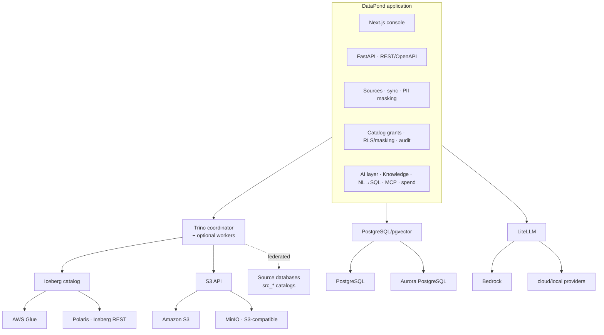

# DataPond Architecture

## 1. Architectural intent

DataPond is a lightweight lakehouse (`PRODUCT_CONCEPT.md` v7): data in S3-API storage as Apache Iceberg, tables in an Iceberg catalog, one SQL engine (Trino), and a governed application layer over them. Each layer sits behind an open contract so it can be replaced without moving data or rewriting SQL. The AI layer (Knowledge/RAG, NL→SQL, MCP, spend) uses the same data and governance; it must also run alone, on profiles with no catalog or engine.



## 2. Portable Core

| Component | Responsibility | Required dependency |
|---|---|---|
| Backend | Auth, Knowledge/RAG, governance, connectors, configuration | PostgreSQL; object/model adapters per operation |
| Frontend | Operator workflows and capability-aware navigation | Backend `/api/capabilities` |
| PostgreSQL + pgvector | Application state, collections, chunks, vectors | PostgreSQL 16 + vector extension |
| LiteLLM | Logical model routing, usage/spend boundary | Configured model provider |
| Valkey | Cache/session support | Optional future reduction target; deployed in current core profile |
| RAG scheduler | Periodic and connector-triggered collection freshness | PostgreSQL and core backend |

Knowledge collection authorization currently uses application-level owner/admin/shared checks. It should not be described as database-enforced collection RLS.

## 3. Adapter boundaries

### Object store

- Contract: S3 API and URI-based source references.
- Current: native Amazon S3 in AWS profiles; S3-compatible service in self-hosted profiles.
- Exit: object copy/version restore; do not store AWS credentials in domain records.

### State and vector

- Contract: PostgreSQL SQL semantics and pgvector.
- Current: in-cluster PostgreSQL or external Aurora PostgreSQL.
- Exit: logical/physical backup and restore; preserve extension version and embedding metadata.

### Model gateway

- Contract: LiteLLM logical model names and OpenAI-compatible calls.
- Current: Bedrock mappings in AWS profiles; local/cloud mappings may be configured by other profiles.
- Exit: rebind logical model names. Re-embed when model dimension or semantic behavior changes.

### Catalog and query

- One engine, Trino, on every profile that has a catalog (Athena removed in 2.4).
- AWS reference: the Glue catalog. OSS profiles: Polaris (Iceberg REST). More catalogs register side by side (`data_catalogs`, kinds `glue`, `iceberg_rest`, `polaris`), each with its own grants.
- **Catalog export** (`app/catalog_export.py`, `POST /api/catalogs/{name}/export`, 2.6): registers a catalog's Iceberg tables in another catalog through Trino's `register_table` procedure, without copying data — the Glue exit path. The chart enables the procedure on every Iceberg catalog it renders; a Polaris target must accept the source's location (`polaris.storage.extraAllowedLocations`).
- **Workers** (`trino.workers.replicas`, 2.6): a worker Deployment reading the same catalogs and credentials; the coordinator then only plans. The backend restarts workers with the coordinator when source catalogs change and reports the engine ready only when both are back.
- No catalog or engine: Lakehouse menus (Catalog, Analytics, Sources, Metrics) are capability-disabled and the AI layer runs alone.

### Sources (connectors)

- Database sources — PostgreSQL, MySQL, SQL Server, Oracle, MongoDB — are **Trino
  catalogs** (`src_<slug>`, 2.5): browsed, federated and synced into Iceberg by Trino
  SQL, with PII masked in the `SELECT`; governed by `catalog_grants` like any catalog.
- REST APIs, custom Python and S3 objects are read by the backend and written to Iceberg.
- The `connectors` capability therefore requires Trino: Portable Core · AWS and Sovereign
  Core have no Sources page; a catalog without the engine has Catalog and no Sources.

## 4. Optional add-ons

| Add-on | Capability | Operational note |
|---|---|---|
| Polaris | Iceberg REST catalog | Use with engines that support REST catalog |
| Trino | Distributed SQL | Not required for RAG |
| RisingWave | Streaming SQL/CDC | Enable only for continuous data flows |
| Airflow + Spark | DAG and batch transforms | Higher footprint |
| OpenMetadata | External catalog/lineage UI | Registration is best-effort |
| Jupyter + DuckDB | Interactive exploration | User-code execution boundary |
| MLflow | Experiment/model tracking | Optional ML workflow |

An add-on being disabled does not mean an equivalent AWS service exists. Provision and wiring are separate infrastructure work.

## 5. Capability model

`GET /api/capabilities` returns:

- stable boolean feature flags used to show/hide modules;
- active query/catalog adapter hints;
- non-secret product profile identity (`profile_id`, label, maturity, topology);
- object, vector, and model gateway hints.

Profile metadata is descriptive. Feature flags remain authoritative. Capability status means **configured**, not **healthy**; health belongs to Services/System APIs.

Optional navigation fails closed until the endpoint returns explicit `true`. Direct routes show the current profile and explain which adapter/add-on is missing.

## 6. Data paths

### Direct Knowledge path

```text
text/S3 → read → chunk → PII mask → embed → pgvector
question → embed → HNSW retrieve → optional rerank → model → cited answer
```

### Catalog bridge

```text
database/object source → Glue or Polaris/Iceberg → Catalog → Send to Knowledge
                                                        ↓
                                               scheduled re-embedding
```

### Governed metrics

```text
approved metric definition (versioned) → sqlglot compile → governed SQL path (RLS/masking) → rows + citation
```

A metric is an administrator-approved definition (aggregate, base table, filters, dimensions, one-hop many-to-one joins within one catalog). A join's target key is checked for uniqueness when an administrator approves it, through the governed path as that administrator, so the check sees only the rows that administrator's RLS allows. `metric_query` builds the SQL deterministically, with no model, and runs it through the same path as `/queries/execute`, so the write classifier, hidden-catalog refusal, RLS and masking apply. The result carries a citation (metric, version, approver, compiled SQL, `rls_applied`, `pii_masked`), and the audit row records `metric:<name>@v<N>`. `/ai/sql` receives approved definitions as prompt context and reports which it was given, not which it used. Versions are append-only by database trigger, the same strength as the audit tables: this stops the application's code paths, not the owning database role, and is not tamper-proof.

### Governance and cost

```text
actor identity → collection ACL / table policy → audit
actor identity → LiteLLM user + metadata → usage/spend aggregation
```

## 7. Deployment architectures

### Portable Core · AWS starter

Kubernetes runs backend, frontend, PostgreSQL/pgvector, LiteLLM, and Valkey. Native S3 and Bedrock are external. No catalog/query service is enabled.

### AWS Single-Node Reference

Terraform creates an EC2/K3s node and connects it to Aurora, S3, Glue, Bedrock, ECR, IAM, Route53, Secrets Manager, and CloudWatch/SNS. The application node is not HA.

### Sovereign OSS Extended

Kubernetes runs core plus selected self-hosted object/model/data add-ons. This increases independence and operational responsibility.

## 8. Current non-goals and roadmap

Not currently provisioned as part of a maintained deployment:

- EKS cluster/node groups and an HA reference topology
- Trino worker autoscaling
- EMR Serverless, S3 Tables, Lake Formation, OpenSearch Serverless/AOSS, DataZone
- Marketplace packaging/billing
- Delta Lake → Iceberg migration tooling
- unified export/import CLI

A managed AWS service may become an optional adapter; it may not become a required part of the core path (`POSITIONING_V7.md`). Historical design files do not change their current status.

## 9. Design rules

1. Keep every layer behind an open contract (S3 API, Iceberg, Iceberg catalog, Trino SQL, PostgreSQL, OpenAI-compatible models); no AWS-only service on the required path.
2. Keep Knowledge/RAG functional with every data add-on disabled.
3. Put provider-specific IDs and credentials behind adapter configuration.
4. Prefer open data/protocol boundaries over bundling more services.
5. Add a navigation capability only when its backend path is configured.
6. Keep health and capability separate.
7. Preserve backward-compatible profile filenames and API boolean keys.
8. Require migration and live acceptance evidence before claiming a new provider as shipped.
