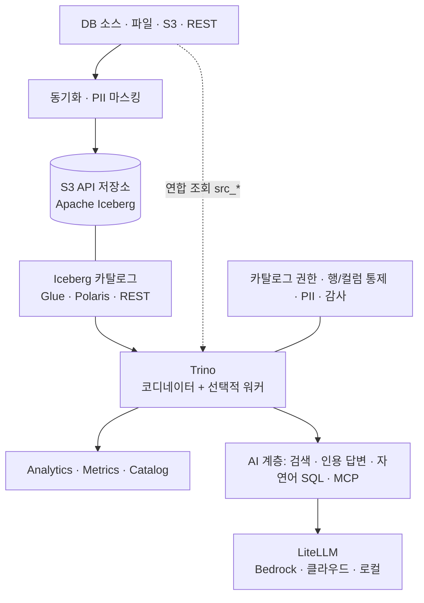

# DataPond 제품 컨셉 — 중소 규모를 위한 가벼운 개방형 레이크하우스

**버전:** 7.0 · **상태:** 현재 제품 기준 · **갱신:** 2026-11-12

> **v7.0 (2026-11-12):** 결정과 근거는 [`POSITIONING_V7.md`](POSITIONING_V7.md). v6.0("AI 에이전트·앱을
> 위한 Governed 데이터 도구 서버")은 대체됐고, 그 기록은 `POSITIONING_REVIEW.md`와
> `POSITIONING_FIT_AUDIT.md`에 남는다.

## 한 문장

> **DataPond는 AWS를 쓰는 중소 규모 팀에게 가벼운 데이터레이크와 데이터 플랫폼을 주는 제품이다.
> 데이터는 S3 API 저장소에 Apache Iceberg로, 테이블 목록은 Iceberg 카탈로그에, 쿼리는 분산 SQL
> 엔진 Trino로 처리한다. 모든 계층이 개방 표준이라 저장소·카탈로그·엔진·모델을 바꿔도 데이터와
> SQL은 그대로다. AI 검색과 에이전트 기능은 그 데이터 위의 활용 계층이다.**

## 해결하는 문제

규모가 크지 않은 팀이 데이터 플랫폼을 가지려 하면 두 길만 보인다.

- **Databricks·Snowflake 같은 완성형 플랫폼.** 기능은 충분하지만 작은 팀에는 무겁고 비싸며, 데이터와
  권한이 플랫폼 안에 묶인다.
- **Athena, Glue, Lambda를 직접 조립.** 싸게 시작하지만 AWS에 묶이고, 외부 DB 연합 조회, 행 단위
  통제, 운영 화면, 동기화 파이프라인을 팀이 계속 만들어야 한다.

DataPond는 그 사이를 제품으로 채운다. **단일 노드에서 시작하는 레이크하우스**를 고객 AWS 계정 안에
두고, 모든 데이터를 개방 형식으로 둬서 나중에 AWS 밖으로도 그대로 옮길 수 있게 한다.

## 핵심 가치

### 1. 개방 레이크하우스 — 계층마다 교체 가능

| 계층 | 개방 표준 | AWS 레퍼런스 | 교체 대상 | 상태 |
|---|---|---|---|---|
| 객체 저장소 | S3 API | Amazon S3 | MinIO 등 S3 호환 | Shipped (MinIO는 CI에서 매번 설치 검증) |
| 테이블 | Apache Iceberg + Parquet | Iceberg | — | Shipped |
| 카탈로그 | Glue · Iceberg REST | AWS Glue | Polaris 등 REST 카탈로그 | Shipped (카탈로그 여러 개 등록·조회·권한) |
| 쿼리 엔진 | Trino | 클러스터 안 Trino 482 | 어느 Kubernetes에서나 같은 Trino | Shipped (2.4에서 Athena 제거) |
| 앱 상태 | PostgreSQL + pgvector | Aurora PostgreSQL | 일반 PostgreSQL | Shipped |
| 모델 | OpenAI 호환 (LiteLLM) | Bedrock | 다른 클라우드·로컬(Ollama) | Shipped |
| 배포 | Helm · Kubernetes | EC2/K3s 단일 노드 | 다른 Kubernetes | Shipped (EKS 모듈은 로드맵) |

**카탈로그 내보내기**(`POST /api/catalogs/{name}/export`, 2.6)는 한 카탈로그의 Iceberg 테이블을 데이터
복사 없이 다른 카탈로그에 등록한다. Glue에서 REST 카탈로그로 떠나는 경로이며, 기본은 계획만 보여
주고 `apply`일 때 등록한 뒤 양쪽 행 수를 비교한다. 상세는 [PORTABILITY.md](PORTABILITY.md).

### 2. 가볍게 시작, 필요할 때 확장

- **AWS 레퍼런스는 단일 노드다.** EC2 t3.xlarge Spot 한 대(K3s) + Aurora Serverless v2 + S3 + Glue.
  평일 업무시간만 켜는 스케줄이 기본이다.
- **Trino 워커로 확장한다**(`trino.workers.replicas`, 2.6). 워커가 붙으면 코디네이터는 계획만 하고
  워커가 실행한다. 워커는 같은 카탈로그와 자격 증명을 읽는다.
- 쓰지 않는 구성 요소는 아예 뜨지 않는다. 화면 메뉴도 실제로 켜진 기능만 보여 준다.

### 3. 데이터 계층 거버넌스

- **카탈로그 권한:** 누가 어느 카탈로그를 쓸 수 있는지(사용자·역할). DB 소스 카탈로그의 권한은 그
  소스의 공유 목록을 따른다.
- **행 필터와 컬럼 마스킹:** SQL 실행 경로(`/queries/execute`)에서 적용. 선택적으로 Trino 파일 기반
  접근 제어(Layer 2)에도 투영한다.
- **개인정보:** 한국형 식별자(주민번호·휴대전화·사업자번호 등)를 적재 시점과 조회 시점에 가린다. DB
  소스 동기화는 Trino `SELECT` 안에서 마스킹해서 원본 값이 레이크에 들어가지 않는다.
- **감사:** 권한 결정과 도구 호출을 append-only로 남기고 NDJSON으로 내보낸다.

### 4. 데이터 위의 AI

레이크하우스 위에 얹는 활용 계층이다. 따로 팔리는 제품이 아니라 같은 데이터·같은 거버넌스를 쓴다.

- Knowledge: 문서·S3·카탈로그 테이블을 적재해 pgvector 검색과 인용 답변.
- 자연어 → SQL 생성과 거버넌스가 적용된 실행.
- Metrics: 관리자가 승인한 버전 관리 지표를 결정적 SQL로 컴파일(모델 없이).
- 에이전트용 read 전용 MCP 서버(`POST /api/mcp`)와 REST, 서비스 계정 키, 호출자별 비용 한도.

## 남은 종속 지점

| 지점 | 왜 종속인가 | 탈출 경로 | 상태 |
|---|---|---|---|
| Glue 카탈로그 (AWS 레퍼런스) | 테이블 목록이 Glue에 있다 | 카탈로그 내보내기로 REST 카탈로그에 등록 | 경로 Shipped, 라이브 Glue→Polaris 실이관은 미검증 |
| Bedrock | 모델 호출 | LiteLLM 매핑 변경 (임베딩 모델이 바뀌면 재임베딩) | Shipped |
| IAM 인스턴스 프로파일 | Trino·백엔드가 S3·Glue를 이 자격으로 호출 | S3 호환 저장소는 접근 키로 연결 | Shipped |
| Terraform 모듈 | EC2/K3s·Aurora·Route53 | Helm 차트는 어느 Kubernetes에서나 동일 | AWS 모듈만 있음 |

## 제품 구조

## 사용자와 주요 여정

### Primary: 중소 규모 데이터팀

- AWS를 적극적으로 쓰고, Databricks를 쓰고 있거나 검토했지만 규모 대비 무겁다고 느끼는 팀.
- 데이터 엔지니어 1–3명이 운영한다. 플랫폼 운영 전담 인력은 없다.
- 첫 여정: **DB·파일 소스 연결 → Iceberg로 동기화 → Catalog에서 확인 → Analytics에서 SQL(레이크와
  원본 DB 연합) → 카탈로그 권한·마스킹 설정 → 필요하면 Knowledge·에이전트로 AI 활용**.

### Secondary: AI 기능을 붙이려는 개발팀

- 같은 데이터에 검색·인용 답변·에이전트 접근을 열고 싶다. 서비스 계정 키, MCP, 호출자별 감사와
  비용 한도를 쓴다.

### 첫 세그먼트

AWS 위의 한국 중소·중견 기업 데이터팀. 개인정보보호법 대응(한국형 식별자 마스킹, 감사 증적)이
걸리는 경우가 많아 이 부분이 차별점이 된다. 수요는 아직 검증되지 않았다(`POSITIONING_V7.md`).

## 메뉴 정보구조

| 영역 | 메뉴 | 원칙 |
|---|---|---|
| Home | Dashboard | 프로필, 핵심 흐름, 상태 |
| Lakehouse | Catalog, Analytics, Sources, Metrics | 카탈로그·쿼리 엔진이 켜졌을 때만. DB 소스(PostgreSQL·MySQL·SQL Server·Oracle·MongoDB)는 Trino 카탈로그 `src_<slug>`, REST·custom·S3는 백엔드가 읽는다 |
| Pipelines | Transforms, Streaming | 해당 add-on을 켰을 때만, 지원 티어 배지 |
| Data Science | Notebooks, Experiments | 해당 add-on을 켰을 때만, 지원 티어 배지 |
| AI | Knowledge, Agents, AI Gateway | 모든 프로필 |
| Operate | Governance, Storage, Infrastructure, Settings | 운영 |
| Learn | Help | shipped/optional/roadmap 구분 |

쿼리 엔진이 없는 프로필(Portable Core, Sovereign Core)은 Lakehouse 메뉴가 숨겨져 AI 영역이 앞에 온다.

## 배포 프로필

- **AWS Single-Node Reference** (`values-prod-single.yaml`): 레이크하우스의 기준 배포. Terraform 기반
  EC2/K3s + Aurora + S3 + Glue + Bedrock, 클러스터 안 Trino.
- **Sovereign OSS Extended** (`values-onprem.yaml`): AWS 밖. MinIO + Polaris + Trino 등 자체 운영.
- **Portable Core · AWS / Sovereign Core** (`values-foundation.yaml`, `values-sovereign-core.yaml`):
  카탈로그·쿼리 엔진 없이 AI 계층만 쓰는 가벼운 시작점.

상세는 [DEPLOYMENT_PROFILES.md](DEPLOYMENT_PROFILES.md).

## 거버넌스 경계

- 카탈로그 권한과 컬렉션 보안은 애플리케이션 수준 ACL이다. PostgreSQL native RLS가 아니다.
- 행 필터·마스킹은 SQL rewrite이며 `/queries/execute` 경로에 적용된다. Trino에 직접 접속하는 클라이언트는
  Layer 2(파일 기반 접근 제어)를 켰을 때만 같은 통제를 받는다. 기본은 꺼져 있다.
- 감사 테이블은 런타임 DB 역할이 UPDATE/DELETE할 수 없지만 스토리지 수준 WORM은 아니다.
- UI capability gate는 UX 경계이며 API 인가를 대체하지 않는다.

## 출구 전략

객체는 S3 API, 테이블은 Iceberg, 카탈로그는 내보내기 경로, 앱 상태는 PostgreSQL dump/restore, 모델은
LiteLLM 매핑 변경으로 옮긴다. `ENCRYPTION_KEY` 없이는 저장된 자격 증명을 복호화할 수 없다. 임베딩
모델이나 차원이 바뀌면 재임베딩이 필요하다. 상세는 [PORTABILITY.md](PORTABILITY.md).

## Open Core 원칙

Community에 남는 것: 레이크하우스 코어(저장소·카탈로그·엔진 연결, 동기화, Catalog·Analytics),
데이터·메타데이터 내보내기와 카탈로그 내보내기, 기본 권한·PII·감사, AI 계층의 기본 기능.

Enterprise 후보: OIDC SSO(현재), 정책 팩, 감사 SIEM/WORM export, 다중 환경 운영, SLA/지원.
고객의 데이터를 옮기는 기능은 상용 edition으로 잠그지 않는다.

## 경쟁 기준

| 대안 | 관계 | DataPond의 자리 |
|---|---|---|
| Databricks | 기능이 넓은 완성형 | 작은 팀에 맞는 크기와 비용, 고객 계정 안, Iceberg 기본 |
| Athena + Glue 직접 조립 | 운영 없음, 쿼리당 과금 | 엔진·카탈로그 종속 없음, 외부 DB 연합, 행 단위 통제, 제품 UI |
| EMR · Starburst · Dremio | 대규모 성능 | 단일 노드부터, 운영 인력 없이 |
| Snowflake | 완성도 | 개방 형식, 데이터가 고객 버킷에 남음 |

## 하지 않을 것

- 핵심 경로를 AWS 전용 관리형 서비스로 바꾸는 것(Athena, Lake Formation 필수화 등)
- 게이트웨이 기능: 에이전트 레지스트리, SSO/SCIM 동기화, tool 단위 정책 엔진
- 대규모 HA 클러스터를 첫 목표로 삼는 것
- Delta Lake 쓰기 (Iceberg가 테이블 형식이다)

## 상태 표기

- **Shipped:** 코드, Helm wiring, 테스트가 존재하고 유지되는 기능.
- **Reference:** 실제 구성이 있으나 topology 제한이 있는 배포.
- **Optional:** 특정 profile/add-on에서만 제공. 지원 티어 배지를 따른다.
- **Roadmap:** 문서나 설계 이력은 있으나 현재 배포가 제공하지 않는 기능.

현재 canonical 문서는 [루트 README](../README.md)와 [active docs index](README.md) 목록이다.
`superpowers/plans`와 `superpowers/specs`는 역사 기록이다.
